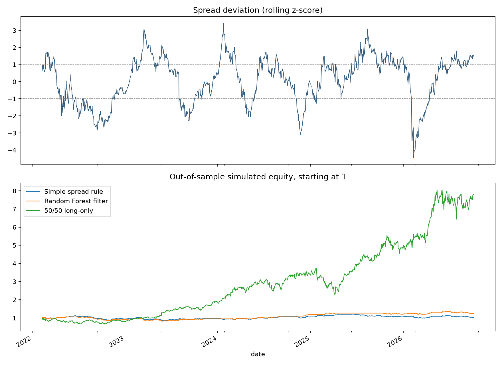

# AI Supply Chain Basket Study

I tested a trading idea: when AI chip stocks run far ahead of companies building power and electrical infrastructure, does the gap tend to close? I built the data pipeline, a simple trading rule, and a machine-learning filter to test that question. **The evidence so far does not support using it as a trading signal.**

## Why I chose this question

AI systems need both chips and physical infrastructure. That connection led to a testable question: do investors sometimes price those two groups so far apart that the gap later closes? The business story makes the question interesting; it does not prove the market behaves that way. My goal was to build the full research process and let the data challenge the idea.

More specifically, I asked two things: **Does a stable long-run relationship exist between the baskets? If it does, can an ML model choose better trades than a simple rule after realistic delays and costs?** A credible result must beat simple comparisons and hold up outside the data used to fit the model.

## The question and the data

The chip basket holds NVDA, AMD, and AVGO. The infrastructure basket holds VRT, ETN, and PWR. I used 1,672 common daily price observations from February 10, 2020, through October 5, 2026. The stocks were chosen with today's knowledge, so this is an illustrative basket study, not a historical sector index.

The price data comes from Yahoo Finance through [yfinance](https://github.com/ranaroussi/yfinance). I saved a local snapshot and its checksum for the reported run. **The downloaded price CSVs are not in this repo.** You can fetch a new copy with the command below; Yahoo may revise its data, so your numbers may differ. The [snapshot manifest](data/manifest.json) records the source, date, stock list, and checksum used for the published findings.

## What I built

1. **Data checks:** align six adjusted closing-price series and flag missing, duplicated, or invalid observations.
2. **Two baskets:** reset each basket to equal stock weights each trading day. Measure the gap between their log values.
3. **A simple rule:** enter when the gap is unusually wide and exit as it moves closer to its recent average. Its *z-score* tells us how far the gap is from that average, measured in standard deviations.
4. **One ML model:** a Random Forest classifier, which combines votes from many decision trees. It predicts whether the gap will fall over the next five trading sessions and filters the simple rule's entries. I did not use a neural network or an LLM to make trades.
5. **A backtest:** fit the model only on past observations, allow one day for a simulated order to fill, and charge trading and short-borrow costs. Save every daily prediction, position, cost, and return locally.

**Cointegration** is the name of the long-run relationship we looked for. Two baskets can each wander over time, yet a suitably weighted gap between them may stay near a usual level. That is different from simply moving in the same direction on a given day. We tested whether this gap showed that behavior; the test did not give us evidence that it does. The cointegration test assumes the individual series have particular time-series properties, which this first study has not separately established.

**Why Random Forest?** The gap's size alone might miss useful context. We gave the model seven measurements available at decision time: the gap's z-score, its recent changes, each basket's recent return, and each basket's recent volatility (how much its returns have varied). A Random Forest can combine those measurements through many decision trees. We used it as a test of whether that extra complexity improves the simple rule. In this run, its direction predictions did not beat a basic guess.

The model is refit every 63 sessions. Six recent sessions are kept out of each training set because their five-session outcome would not have been known at that point. The first 504 sessions set the basket hedge ratio; later sessions are evaluated out of sample. The [research brief](PROJECT_BRIEF.md) records the original idea, and the [full report](results/REPORT.md) explains the assumptions.

## What the first run found

| Check | Result |
|---|---:|
| Training-period cointegration test | p = 0.7165 |
| Training-period spread stability test | p = 0.4809 |
| Random Forest direction accuracy | 50.78% |
| Always-guess-the-majority accuracy | 50.86% |
| Simple rule, simulated total return after modeled costs | 2.75% |
| ML-filtered rule, simulated total return after modeled costs | 23.81% |

The statistical tests did not find evidence for the stable relationship this strategy needs. The classifier predicted direction slightly worse than the simple majority guess. The ML-filtered backtest made money in this sample, mostly in 2024, but that alone does not show the model found a repeatable edge. The result is a **research no-go**, not a live trading robot. [See the full findings and yearly results.](results/REPORT.md)



## Run it yourself

Use Python 3.14. From the repository folder:

```powershell
python -m venv .venv
.\.venv\Scripts\python -m pip install -r requirements.txt
.\.venv\Scripts\python -m unittest discover -s tests -v
.\.venv\Scripts\python -m src.cli all
```

On macOS or Linux, activate `.venv` and use `python` in place of `.\.venv\Scripts\python`. The `all` command fetches prices if the local CSV is absent, then creates `results/REPORT.md`, `results/results.json`, `results/study_chart.png`, and `results/out_of_sample_daily.csv`. To run again on the same local data, use `python -m src.cli run`. To deliberately fetch a new snapshot, use `python -m src.cli all --refresh`.

Automated tests cover missing and duplicate data, basket math, delayed execution costs, and the gap between training labels and future test dates. GitHub Actions runs those tests without downloading market data.

## What comes next

I would first compare the ML filter with a random trade-skipping filter and inspect the 2024 trades that drove its gain. If the model adds no clear value, I would write a new hypothesis before testing another basket or spread definition. Any promising follow-up would still need an untouched future paper-trading period and better execution data before real-money use.
